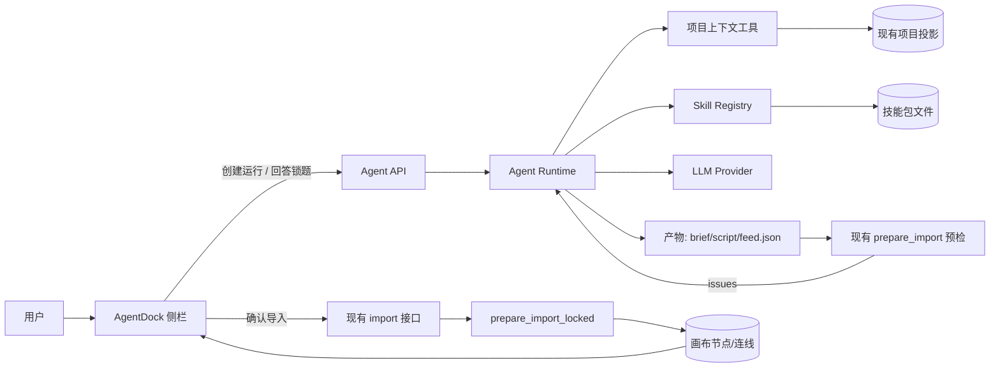
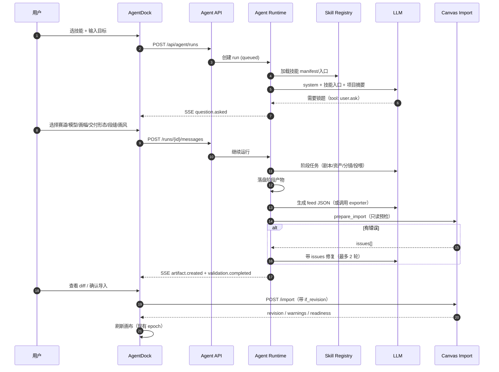

# 01 · 架构与边界

## 1. 现状：已经有一条成熟的导入链

当前画布并不缺“导入能力”，缺的是“谁来生产导入载荷”。现有链路已经具备：

| 环节 | 现有实现 | 位置 |
|---|---|---|
| 统一契约 | `drama-canvas-feed/v2` | `schemas/canvas_feed.schema.json` |
| 声明层校验 | schema + 资产/音色/引用规则 | `canvas_feed_contract.analyze_declared_feed()` |
| 构建画布 | feed → nodes/edges/episodeImports | `import_feed.build_payload()` |
| 集级合并 | 按 `episode_title` 合并、资产复用 | `import_feed.merge_payload_by_episode()` |
| 产物层校验 | 实际接线、音色入边、图片入边 | `canvas_feed_contract.validate_final_payload()` |
| 纯规划 | 不写库，返回 ImportPlan | `prepare_import()`（`canvas_feed_contract.py:1615`） |
| 原子提交 | 项目锁 + revision + 重试 | `prepare_import_locked()`（`:1694`） |
| HTTP | preview / commit | `server.py:8490` |
| 前端手动导入 | 选文件 → preview → 确认 → commit | `web-vimax/src/main.tsx:613` |
| 溯源 | 集级 provenance / warnings | `_source_provenance()`（`canvas_feed_contract.py:1516`） |

所以本项目的正确做法是：**把“生产 feed”的智能体接到这条链的入口，而不是另建一套画布写入。**

## 2. 目标架构



### 2.1 组件职责

| 组件 | 职责 | 不做什么 |
|---|---|---|
| **AgentDock（前端）** | 对话、技能选择、锁题、进度、产物预览、导入确认 | 不改画布 state；不直接拼节点 |
| **Agent API** | 鉴权、租户/项目范围、运行 CRUD、SSE、导入包装 | 不做提示词编排 |
| **Agent Runtime** | 状态机、模型调用、工具循环、上下文预算、修复循环、产物落盘 | 不直接写画布 |
| **Skill Registry** | 包上传、校验、版本、激活、索引、权限 | 不执行未授权脚本 |
| **Context/Tools** | 项目摘要、资产台账、节点详情、技能文档检索、feed 校验、导入预览 | 不越过项目/租户边界 |
| **Exporter（可选）** | 运行技能自带的确定性导出器 | 不在主进程执行任意代码 |
| **现有 Import** | 两道路由闸 + 原子提交 + 溯源 | 不为 Agent 改语义 |

### 2.2 关键边界

1. **写边界**：Agent 只能产出 `feed.json`。唯一写画布的动作是用户确认后调用现有导入接口。Agent 运行中的“预检”是只读的 `prepare_import()`，不落库。
2. **读边界**：Agent 读取项目时只拿**紧凑摘要 + 按需节点详情 + 资产台账**，不把完整 1.8MB payload 喂给模型。
3. **租户边界**：所有技能、运行、产物、导入都带 `tenant_id`；文件路径按租户隔离。
4. **画布边界**：`CanvasView` 不改；只在 `main.tsx` 挂一个可折叠的侧栏；导入成功后沿用现有 `setCanvasEpoch` 刷新。
5. **失败边界**：Agent 模块异常不得影响画布路由；模型不可用时可降级为“只手动导入”。

## 3. 端到端数据流



## 4. 部署形态：先同进程，后按需拆

### 推荐（v1）：同进程 + 后台线程

- 新增 `agent/` Python 包，`server.py` 的 GET/POST 路由里转发到 `agent.api`。
- Agent run 使用独立线程池/工作线程（类似现有 generation worker），不占用 HTTP 请求线程。
- 复用现有租户 ContextVar、SQLite 连接、audit、model catalog。
- 优点：部署简单、无新中间件、事务/锁与画布一致；适合当前单机 + SQLite。

### 何时拆分

当出现以下任一情况再拆独立服务：

- 单机并发 run > 20 或 SSE 连接 > 100；
- Agent 运行需要独立扩容/重启，不影响画布 API；
- 需要引入 Redis/任务队列/多副本。
拆分时保持 API 契约不变；运行时通过内部 HTTP/队列调用，产物存储共享。

## 5. 模块落位建议

### 后端

```text
agent/
  __init__.py
  api.py          # 路由分发、鉴权、SSE
  runtime.py      # 状态机、主循环、修复循环
  skills.py       # 包上传/校验/版本/索引/激活
  context.py      # 项目摘要、资产台账、节点详情
  tools.py        # 工具注册与执行（只读/校验/提问/落盘）
  llm.py          # provider 适配、tool calling / JSON 降级
  exporter.py     # 可选脚本导出器（沙箱）
  contracts.py    # schema/hash/feed 校验封装
  store.py        # agent_* 表读写
  events.py       # run SSE 事件
  models.py       # dataclass / 输入输出模型
```

- 路由接入点：`server.py` 的 `_do_get` / `_do_post` 在现有 `/api/` 分支前增加 `if path.startswith('/api/agent/'): return agent_api.handle(...)`。
- 存储路径：`data/tenants/<tenant>/agent/skills/<skillId>/<version>/`、`.../agent/runs/<runId>/`。
- 不改 `canvas_store.py` 的现有表；新增独立表（见 04）。

### 前端

```text
web-vimax/src/agent/
  AgentDock.tsx        # 右侧面板外壳（折叠/拖宽/移动端全屏）
  AgentRunView.tsx     # 对话、步骤、锁题、产物、导入
  SkillLibrary.tsx     # 技能库（上传/版本/激活）
  agentApi.ts          # /api/agent 客户端
  agentEvents.ts       # SSE / 事件归并
  agentTypes.ts        # 类型
  agent.css            # 仅新增样式，复用 tokens
```

- 挂载点：`main.tsx` 画布容器旁（`<AgentDock projectId={pid} />`），不改 `CanvasView` props。
- 导入后刷新：沿用现有 `setCanvasEpoch(v => v + 1)`（`main.tsx:148/1220`）。
- 手动导入入口保留；Agent 只是第二个入口。

## 6. 与现有画布功能的兼容性核对

| 现有能力 | 是否改动 | 说明 |
|---|---|---|
| 画布节点编辑/拖拽/编组 | 否 | 不改 CanvasView |
| 单节点/批量生成 | 否 | Agent 不触发付费生成 |
| 手动导入 feed | 否 | 原入口保留，行为不变 |
| 项目快照/恢复 | 否 | Agent 导入仍走现有 auto snapshot |
| 分享/只读 | 否 | 只读会话不开放 Agent 运行 |
| 项目列表/切集 | 否 | 侧栏独立状态 |
| 画布刷新 | 否 | 复用 epoch + 现有 workspace 加载 |
| 审计 | 增 | 新增 agent.* 事件，不影响 import.* |

## 7. 关键工程约束

- **一次导入只对应一个集**：feed 的 `episode_title` 决定目标集；Agent 运行可选“新建集/追加现有集”，但必须让用户确认。
- **导入前 revision 冻结**：预览拿 revision，提交带 `if_revision`；项目在此期间变化，现有导入会自动重检并给 `WARN_RETRIED_AFTER_REVISION`。
- **资产复用优先**：Agent 上下文必须带现有资产台账（code/semantic/series/variant），避免重复建角色/场景。
- **失败不写库**：预检失败只返回 issues；用户可让 Agent 修，或下载 JSON 手动改。
- **运行可恢复**：每次工具调用/阶段产物落库，进程重启后可从最近 checkpoint 继续或安全失败。

## 8. 反模式（明确不要做）

1. 新建 `agent-canvas.json` 格式，再写一套导入器。
2. Agent 直接调用 `update_project` 改 nodes/connections。
3. 把 1.27M 字技能包一次塞进上下文。
4. 让用户上传的 Python 脚本在主进程里跑。
5. 导入自动化、无预览、无 revision 校验。
6. 把 Agent 运行状态塞进 `CanvasView` 的 129 个 state 里。
7. 让技能包绕过 schema/hash 校验。

## 9. 预计改动文件清单（MVP）

| 文件/目录 | 改动 | 风险 |
|---|---|---|
| `server.py` | 增加 `/api/agent/*` 路由分发（约几十行） | 低；路由前缀隔离 |
| `agent/`（新增） | 技能/运行/工具/存储/API | 新代码，不影响现有模块 |
| `docs/agent/`（新增） | 本文档集 | 无 |
| `web-vimax/src/main.tsx` | 挂载 `AgentDock`（可选/懒加载） | 低；不改画布逻辑 |
| `web-vimax/src/agent/`（新增） | 侧栏/技能库/SSE/API 客户端 | 新代码；按需加载 |
| `web-vimax/src/CanvasView.tsx` | **不改** | — |
| `canvas_store.py` | **不改现有表**；新增 `agent_*` 表走独立迁移 | 低；只加表 |
| `canvas_feed_contract.py` | **不改**（可选：provenance 增加 `agentRunId`） | 低；向后兼容 |
| 依赖 | 不新增前端重型依赖；Python 仅标准库 | 低 |

这个清单的原则：**能新增就不修改，必须修改的地方只加路由/挂载点，不碰画布状态机。**
