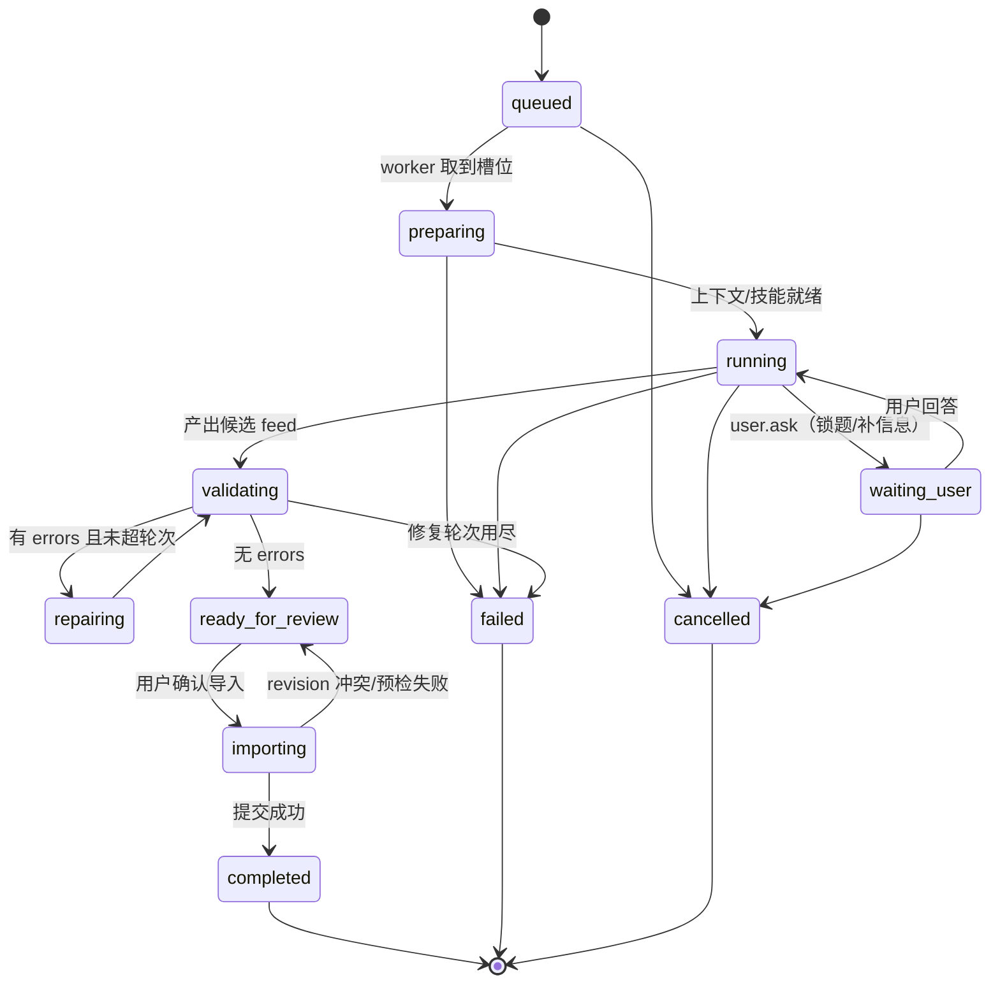

# 04 · Agent 运行时、API 与数据模型

## 1. 运行状态机



状态持久化在 `agent_runs.status`；进程重启时：

- `queued`：重新入队；
- `running/repairing/validating`：标为 `interrupted`，从最近 step 继续或安全失败；
- `waiting_user`：保持，等用户回答；
- `importing`：检查是否已提交，未提交则回到 `ready_for_review`。

---

## 2. 一次运行的内部步骤

1. **创建**：固定 `projectId`、`episodeId`（可空=新建集）、`skillVersionIds`、模型、预算、prompt；写 `clientRunId` 幂等键。
2. **取槽位**：租户/全局并发限制；同一项目默认只允许 1 个活跃 run（可配置 2）。
3. **准备上下文**：项目 brief、资产台账、技能入口、锁题答案、历史 run 摘要。
4. **主循环**：调用 LLM；模型返回文本或 tool calls；执行工具；写 message/step。
5. **锁题**：需要用户选择时发 `question.asked`，run 进入 `waiting_user`，释放 worker。
6. **落产物**：每个阶段写 artifact（brief/script/assets/segments/feed）。
7. **候选 feed**：调用 `feed.validate`（服务端 `prepare_import` 只读）；有错则进入修复循环。
8. **待审**：无错 → `ready_for_review`，前端显示 diff/警告。
9. **导入**：用户确认 → 调现有导入逻辑；成功后 `completed`，写 `agent_imports`。
10. **结束**：记录 usage、耗时、token、修复轮次、feed sha256。

---

## 3. 工具清单（Agent 只能通过这些工具行动）

| 工具 | 权限 | 输入 | 输出 | 说明 |
|---|---|---|---|---|
| `project.get_brief` | 只读 | `projectId, episodeId?` | 紧凑项目摘要 | 不含全量 prompt/媒体 |
| `project.search_assets` | 只读 | `query, kinds?, limit?` | 资产列表（code/semantic/series/variant/title） | 用于复用 |
| `project.get_node` | 只读 | `nodeId` | 单节点摘要（prompt 截断） | 按需，不批量拉全量 |
| `project.export_ledger` | 只读 | `projectId` | feed 兼容的资产台账文件 | 给 exporter 用 |
| `skill.search` | 只读 | `skillVersionId, query, limit?` | 文档片段（带路径/标题） | 检索技能 references |
| `skill.read` | 只读 | `skillVersionId, path, section?` | 文档内容/切片 | 路径白名单 |
| `artifact.write` | 写产物 | `runId, kind, content` | artifactId | 阶段产物 |
| `feed.validate` | 只读 | `runId, feed` | errors/warnings/summary | 调 `prepare_import`，不写库 |
| `feed.preview_import` | 只读 | `runId, feed` | 导入 diff/摘要 | 可选，和 validate 同源 |
| `user.ask` | 交互 | 问题、选项、multi | 用户答案 | 进入 waiting_user |
| `finalize.feed` | 写产物 | `runId, artifactId` | 候选 feed | 进入 validating |
| `exporter.run` | 受限 | `skillVersionId, inputArtifactId` | feed artifact | 仅信任包/沙箱开启 |

**禁止工具**：任意 HTTP、任意文件读、SQL、直接 `update_project`、直接生成付费媒体、读取其他项目/租户。

---

## 4. 上下文编译器

### 4.1 预算分层

| 区块 | 建议上限 | 内容 |
|---|---|---|
| system/contract | 3k tokens | 角色、工具、feed 契约摘要、硬规则 |
| skill entry | 8–12k | 总控/当前阶段入口 |
| skill references | 8–16k | 检索片段，按需 |
| project brief | 4–8k | 项目/集/资产摘要 |
| conversation | 4–8k | 最近消息 + 早期摘要 |
| output reserve | 4–8k | 单次生成上限 |

### 4.2 项目 brief 结构

```json
{
  "projectId": "…",
  "title": "铁西硬汉",
  "revision": 13275,
  "activeEpisodeId": "EP007",
  "episodes": [{"id": "EP001", "title": "第01集", "nodeCount": 27}],
  "assetSummary": {
    "total": 80,
    "byKind": {"image": 60, "audio": 12, "video": 8},
    "reusable": [
      {"code": "图1", "semanticCode": "CHR-001", "title": "角色｜赵铁柱（图1）", "seriesId": "character:赵铁柱", "variantKey": "default", "hasMedia": true}
    ]
  },
  "feedProvenance": {"skillVersion": "7.4.29", "packageRevision": "…"},
  "styleLocks": {},
  "recentRuns": [{"runId": "…", "status": "completed", "at": "…"}]
}
```

### 4.3 检索策略

- 上传时为每个技能文件建轻量索引：路径、标题、二级标题、关键词、前 200 字。
- `skill.search` 只返回 top 3–5 片段，每段 ≤ 1200 tokens。
- `skill.read` 支持按标题切片；单次 ≤ 4000 tokens。
- 阶段切换时清掉上一阶段的大段文档，只保留“已完成清单 + 状态台账”。

---

## 5. LLM 适配层

### 5.1 接口

```python
class AgentLLM:
    def chat(
        self,
        messages: list[dict],
        tools: list[dict] | None = None,
        response_format: dict | None = None,
        max_tokens: int = 4000,
    ) -> LLMResult: ...
```

`LLMResult` 至少含：`text`、`tool_calls`、`usage`、`raw`。

### 5.2 能力分级

1. **原生 tool calling**（优先）：直接消费 `tool_calls`。
2. **JSON 模式/结构化输出**：要求模型输出 `{"thought": "...", "tool": "...", "args": {...}}`。
3. **纯文本降级**：要求输出严格 JSON；服务端提取第一个 JSON 对象并重试一次。

无论哪一级，**最终都以服务端校验为准**，不信模型自述“已通过”。

### 5.3 现有基础

- `provider_client._openai_chat()` 已有 OpenAI 兼容的 `/chat/completions` 调用；
- 新增 Agent 适配层只扩展 tools/messages/usage，不重写供应商协议；
- 模型选择复用 `provider_catalog` 的文本能力模型。

---

## 6. HTTP API

统一前缀 `/api/agent`，沿用现有 session/tenant 鉴权与错误格式。

### 6.1 技能

| 方法 | 路径 | 说明 |
|---|---|---|
| GET | `/skills` | 列出已安装技能/版本/状态/契约 hash |
| POST | `/skills/uploads` | 上传 zip（multipart 或分片）→ staging + 校验 |
| POST | `/skills/uploads/{uploadId}/activate` | 激活为一个不可变版本 |
| GET | `/skills/{skillId}/versions` | 版本列表 |
| POST | `/skills/{skillId}/versions/{version}/activate` | 切换 active |
| POST | `/skills/{skillId}/versions/{version}/rollback` | 回滚到已知版本（activate 的别名） |
| DELETE | `/skills/{skillId}` | 软删除（有运行引用时拒绝硬删） |

### 6.2 运行

| 方法 | 路径 | 说明 |
|---|---|---|
| POST | `/runs` | 创建运行 |
| GET | `/runs/{runId}` | 运行快照 |
| GET | `/runs/{runId}/events` | SSE（支持 Last-Event-ID） |
| POST | `/runs/{runId}/messages` | 用户消息/锁题答案 |
| POST | `/runs/{runId}/cancel` | 取消 |
| GET | `/runs/{runId}/artifacts` | 产物列表 |
| GET | `/runs/{runId}/artifacts/{artifactId}` | 产物内容（JSON/text） |
| POST | `/runs/{runId}/validate` | 对候选 feed 重新预检 |
| POST | `/runs/{runId}/import` | 确认导入（薄包装现有导入） |
| GET | `/runs?projectId=...` | 项目运行历史 |

### 6.3 创建运行

```json
POST /api/agent/runs
{
  "clientRunId": "uuid",
  "projectId": "sj80...",
  "episodeId": null,
  "skillVersionIds": ["manju-laoli-skill@7.4.29@20261105-r14"],
  "prompt": "做一集 90 秒的短剧，重生复仇，Seedance 2.5，竖屏",
  "mode": "co_create",
  "model": null,
  "budget": {"maxTokens": 120000, "maxCost": 5.0, "currency": "CNY"}
}
```

返回：

```json
{
  "runId": "arun_...",
  "status": "queued",
  "projectId": "sj80...",
  "createdAt": "2026-11-09T..."
}
```

### 6.4 用户回答

```json
POST /api/agent/runs/{runId}/messages
{
  "message": "已选完锁",
  "answers": [
    {"questionId": "track", "selected": ["国内剧"]},
    {"questionId": "aspect", "selected": ["9:16"]}
  ]
}
```

### 6.5 确认导入

```json
POST /api/agent/runs/{runId}/import
{
  "artifactId": "art_feed_...",
  "ifRevision": 13275,
  "targetEpisode": null
}
```

返回与现有导入一致，另加：

```json
{
  "ok": true,
  "runId": "arun_...",
  "revision": 13276,
  "episodeId": "EP009",
  "nodes": 23,
  "connections": 41,
  "warnings": [],
  "provenance": {...}
}
```

---

## 7. SSE 事件

事件 envelope：

```json
{
  "id": 42,
  "type": "validation.completed",
  "runId": "arun_...",
  "at": "2026-11-09T...",
  "data": {}
}
```

| type | 关键字段 | 用途 |
|---|---|---|
| `run.status` | status, phase | 顶部状态 |
| `message.delta` | messageId, delta | 流式文本 |
| `message.completed` | messageId, text | 完成一条消息 |
| `step.started/completed` | stepId, kind, title | 时间线 |
| `tool.started/result` | tool, args, resultSummary | 工具轨迹 |
| `question.asked` | questionId, title, options, multi | 锁题卡 |
| `artifact.created` | artifactId, kind, size | 产物卡 |
| `validation.completed` | ok, issues, warnings, summary | 预检结果 |
| `import.preview` | revision, diff, warnings | 导入预览 |
| `import.committed` | revision, episodeId | 导入成功 |
| `run.completed/failed/cancelled` | reason | 终态 |
| `usage.updated` | tokens, cost | 费用 |

SSE 细节：

- 事件持久化到 `agent_events`（每 run 最近 2000 条）；
- 断线重连带 `Last-Event-ID` 补发；
- 心跳 15s；
- 每个 SSE 连接一个线程（与现有画布 SSE 一致），但 Agent 面板同一时间只开一个。

---

## 8. 数据库设计（SQLite，新表）

```sql
CREATE TABLE agent_skills (
  id TEXT NOT NULL,
  tenant_id TEXT NOT NULL,
  slug TEXT NOT NULL,
  display_name TEXT NOT NULL,
  kind TEXT NOT NULL,
  active_version TEXT DEFAULT '',
  status TEXT NOT NULL DEFAULT 'active',
  created_by TEXT DEFAULT '',
  created_at TEXT NOT NULL,
  updated_at TEXT NOT NULL,
  PRIMARY KEY (tenant_id, id)
);

CREATE TABLE agent_skill_versions (
  id TEXT PRIMARY KEY,
  tenant_id TEXT NOT NULL,
  skill_id TEXT NOT NULL,
  version TEXT NOT NULL,
  package_revision TEXT NOT NULL,
  manifest_json TEXT NOT NULL,
  package_sha256 TEXT NOT NULL,
  contract_schema TEXT NOT NULL,
  contract_sha256 TEXT NOT NULL,
  storage_path TEXT NOT NULL,
  file_count INTEGER DEFAULT 0,
  bytes INTEGER DEFAULT 0,
  status TEXT NOT NULL DEFAULT 'ready',
  validation_json TEXT DEFAULT '{}',
  created_by TEXT DEFAULT '',
  created_at TEXT NOT NULL,
  UNIQUE (tenant_id, skill_id, version, package_revision)
);

CREATE TABLE agent_runs (
  id TEXT PRIMARY KEY,
  tenant_id TEXT NOT NULL,
  project_id TEXT NOT NULL,
  episode_id TEXT DEFAULT '',
  skill_version_ids_json TEXT NOT NULL,
  client_run_id TEXT DEFAULT '',
  status TEXT NOT NULL,
  phase TEXT DEFAULT '',
  mode TEXT DEFAULT 'co_create',
  prompt TEXT NOT NULL,
  model TEXT DEFAULT '',
  budget_json TEXT DEFAULT '{}',
  input_json TEXT DEFAULT '{}',
  feed_sha256 TEXT DEFAULT '',
  error TEXT DEFAULT '',
  revision_at_start INTEGER DEFAULT 0,
  created_by TEXT DEFAULT '',
  created_at TEXT NOT NULL,
  started_at TEXT DEFAULT '',
  finished_at TEXT DEFAULT ''
);
CREATE INDEX idx_agent_runs_project ON agent_runs (tenant_id, project_id, created_at DESC);
CREATE UNIQUE INDEX idx_agent_runs_client ON agent_runs (tenant_id, client_run_id) WHERE client_run_id <> '';

CREATE TABLE agent_messages (
  id TEXT PRIMARY KEY,
  run_id TEXT NOT NULL,
  role TEXT NOT NULL,
  content TEXT DEFAULT '',
  tool_name TEXT DEFAULT '',
  tool_args_json TEXT DEFAULT '{}',
  tool_result_json TEXT DEFAULT '{}',
  tokens_in INTEGER DEFAULT 0,
  tokens_out INTEGER DEFAULT 0,
  created_at TEXT NOT NULL
);
CREATE INDEX idx_agent_messages_run ON agent_messages (run_id, created_at);

CREATE TABLE agent_steps (
  id TEXT PRIMARY KEY,
  run_id TEXT NOT NULL,
  seq INTEGER NOT NULL,
  kind TEXT NOT NULL,
  status TEXT NOT NULL,
  title TEXT DEFAULT '',
  detail_json TEXT DEFAULT '{}',
  started_at TEXT NOT NULL,
  finished_at TEXT DEFAULT '',
  UNIQUE (run_id, seq)
);

CREATE TABLE agent_artifacts (
  id TEXT PRIMARY KEY,
  run_id TEXT NOT NULL,
  kind TEXT NOT NULL,
  version INTEGER DEFAULT 1,
  path TEXT NOT NULL,
  sha256 TEXT NOT NULL,
  size INTEGER DEFAULT 0,
  meta_json TEXT DEFAULT '{}',
  created_at TEXT NOT NULL
);
CREATE INDEX idx_agent_artifacts_run ON agent_artifacts (run_id, created_at);

CREATE TABLE agent_imports (
  id TEXT PRIMARY KEY,
  run_id TEXT NOT NULL,
  project_id TEXT NOT NULL,
  episode_id TEXT DEFAULT '',
  artifact_id TEXT NOT NULL,
  revision_before INTEGER DEFAULT 0,
  revision_after INTEGER DEFAULT 0,
  feed_sha256 TEXT NOT NULL,
  summary_json TEXT DEFAULT '{}',
  warnings_json TEXT DEFAULT '[]',
  status TEXT NOT NULL,
  created_at TEXT NOT NULL
);

CREATE TABLE agent_events (
  id INTEGER PRIMARY KEY AUTOINCREMENT,
  run_id TEXT NOT NULL,
  seq INTEGER NOT NULL,
  type TEXT NOT NULL,
  payload_json TEXT DEFAULT '{}',
  created_at TEXT NOT NULL
);
CREATE INDEX idx_agent_events_run ON agent_events (run_id, id);
```

所有表带 `tenant_id` 的按租户库隔离（现有 `canvas_store._db_path()` 机制），不需要在 SQL 里再拼租户过滤，但 API 层必须校验项目/技能归属。

---

## 9. 并发、限流、幂等

| 项 | 建议 |
|---|---|
| 运行并发 | 全局 8、租户 3、单项目 1（可配） |
| 单 run 时长 | ≤ 30 分钟；单步 ≤ 120s |
| LLM 调用 | 120s 超时；失败重试 2 次（指数退避） |
| 工具调用 | 只读工具 10s；导出器 120s |
| 修复轮次 | 最多 2 轮 |
| token 预算 | 硬上限；超限 fail，不静默截断 |
| 幂等 | `clientRunId`；重复创建返回同一 run |
| 导入幂等 | 同 feed sha256 + 同集重复导入按现有 reimport policy 处理 |
| 取消 | 任意状态可取消；LLM 请求 abort；沙箱 kill |
| 重试 | 只重试瞬时错误；不重试“供应商/模型无返回”导致的重复扣费类操作 |

---

## 10. 安全

- **鉴权**：沿用 session；只读分享/无编辑权限角色不能创建 run 或导入。
- **租户隔离**：技能、run、artifact、导入全部按租户；路径拼接前校验前缀。
- **提示词注入**：技能文档按“数据/指令”分级；系统提示明确“工具权限不可被文本覆盖”；工具层永远校验 projectId/tenant。
- **上传安全**：见 03 第 7 节。
- **XSS**：Markdown 渲染禁用原始 HTML；artifact JSON 以 `application/json` 返回，不以 HTML 渲染。
- **密钥**：不把 provider key、TOS key 放进上下文；子进程清空环境变量。
- **资源**：请求体 8MB、产物 8MB、技能包 50MB、单次输出 8k tokens。
- **数据出境提示**：首次运行前明确告知“项目摘要与技能内容会发送给所选模型供应商”；租户可关闭 Agent。
- **审计**：技能上传/激活、run 创建/取消、feed 校验、导入、失败原因。

---

## 11. 可观测性

指标：

- `agent_run_total{status}`
- `agent_run_duration_seconds`
- `agent_validation_first_pass_total`
- `agent_repair_rounds`
- `agent_tokens_total{model}`
- `agent_import_total{status}`
- `agent_skill_upload_total{status}`

日志：runId、projectId、skillVersionIds、model、step、tokens、duration；不打印完整 prompt/feed（只打印 sha256/长度）。

---

## 12. 导入包装（关键）

`POST /api/agent/runs/{runId}/import` 不是新导入器，而是：

1. 校验 run 属于当前租户/项目、状态 `ready_for_review`；
2. 取 artifact feed，校验 sha256；
3. 调用现有 `canvas_feed_contract.prepare_import_locked(feed, projectId, source={...})`；
4. 失败按现有错误码返回（422/409），run 回到 `ready_for_review`；
5. 成功写 `agent_imports` + audit，run 置 `completed`；
6. 返回与现有导入一致的 summary/readiness/provenance。

`source` 建议：

```json
{
  "name": "agent:arun_...:feed.json",
  "skillVersion": "7.4.29",
  "packageRevision": "20261105-r14",
  "agentRunId": "arun_..."
}
```

这样 **画布的导入语义 100% 不变**，Agent 只是多了一个调用者。